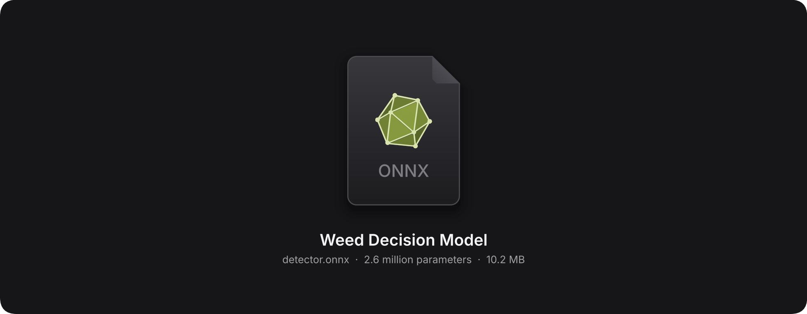
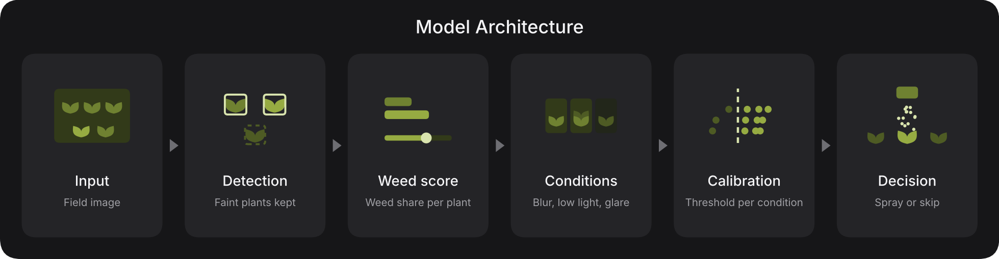
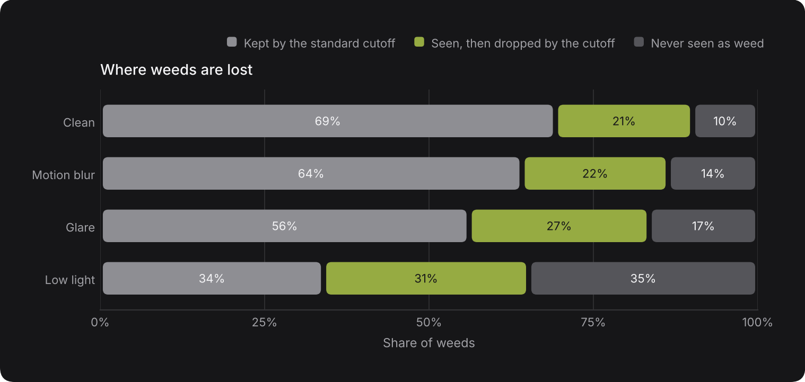
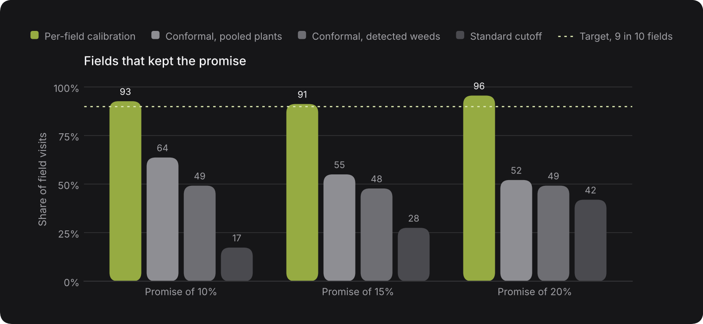
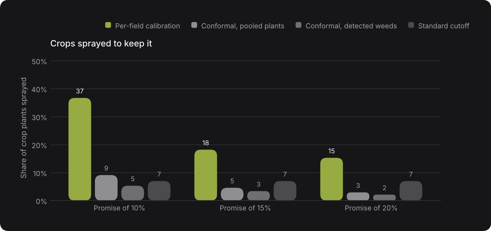
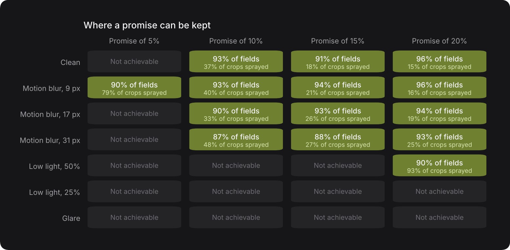
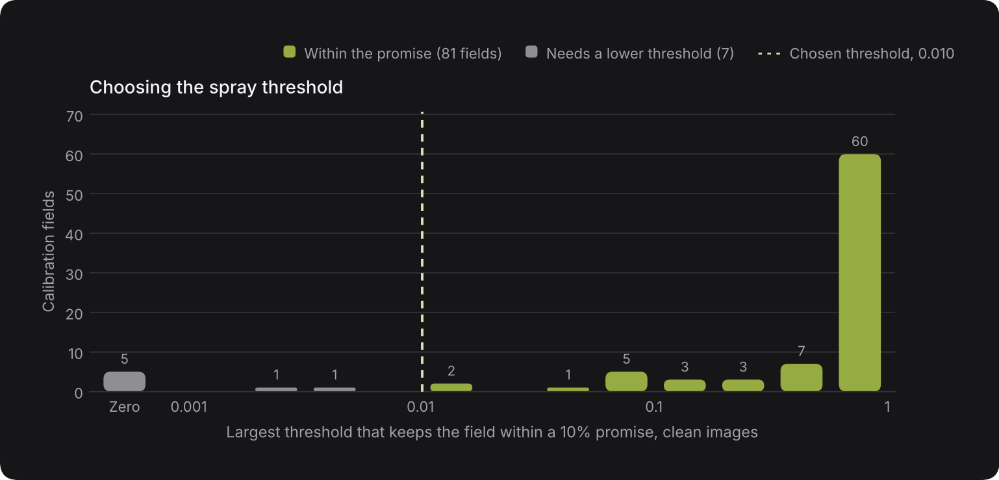

# Weed Decision Intelligence



Weed Decision Intelligence is a model that decides, plant by plant, whether a sprayer should spray or skip. It reads a camera frame from a field and returns a decision for every plant it finds, together with a promise the decision is built to keep: the share of weeds left unsprayed in a field stays at or below a chosen rate, such as 10%, in at least 9 of 10 new fields. When a field condition makes that promise impossible to keep, the model says so and sprays every plant rather than let weeds through.

## How It Works



**Input.** The model reads one colour frame from a downward-facing camera, 1920 × 1088 pixels, together with two settings from the machine: the field condition it is working in and the weed miss rate it should promise. The condition comes from the machine's own speed and exposure, so the model never has to guess it from the image.

**Detection.** A YOLO11n detector, fine-tuned on crops and weeds, finds every plant in the frame and gives each one a crop confidence and a weed confidence. A detector normally discards anything below a confidence of 0.25. Here every detection down to 0.01 is kept, because a weed seen faintly is still a weed the sprayer can reach. The detector is the only learned part of the model, at 2.6 million parameters.

**Weed score.** Each plant receives one score, its weed confidence divided by the sum of its weed and crop confidence. The score reads as the share of the detector's belief that points to weed, which stays meaningful when both confidences are low, as they are for faint plants. A weed the detector does not find at all scores 0, so it counts against the promise instead of disappearing from it.

**Conditions.** The model is calibrated separately for seven conditions a moving sprayer meets: clean images, motion blur of 9, 17 and 31 pixels as ground speed rises, low light at 50% and 25% exposure, and glare from overexposure in direct sun. Each condition degrades the detector differently, so each needs its own threshold.

**Calibration.** For every calibration field, the model finds the largest threshold that would have kept that field within the promise. It then chooses the threshold that 9 in 10 of those fields can tolerate. Because the choice is made over whole fields rather than individual plants, the promise carries over to new fields in the same way. One threshold is stored for every condition and promise, a table of 28 values.

**Decision.** Every plant whose weed score reaches the threshold is sprayed. If no threshold above zero keeps the promise under the current condition, the model reports the promise as not achievable and sprays every plant, so the cost of a hard condition is extra spray, never missed weeds.

## How It Performs

The model is tested on 121 field visits it has never seen, and judged on the 69 that contain at least 20 weeds, where a miss rate is meaningful. A promise counts as kept in a field when that field's share of unsprayed weeds is at or below the promised rate, and the measure is the share of fields where it is kept. The model is compared with three other ways of choosing a threshold from the same detector and calibration data: the standard 0.25 cutoff, conformal calibration over detected weeds only, and conformal calibration over all plants pooled together.

<p>
  
  <br>
  <sub><b>Where weeds are lost.</b> Every weed in the test fields, sorted by what happens to it under the standard 0.25 cutoff. On clean images the detector sees 90% of weeds, yet only 69% pass the cutoff. The 21% in between are weeds the detector found and then discarded, and they outnumber the weeds it never saw. Under low light the two losses grow to 31% and 35%. Keeping faint detections recovers the middle group, which is where most of the gain is.</sub>
</p>

<br>

<p>
  
  <br>
  <sub><b>Fields that kept the promise.</b> The share of test fields whose weed miss rate stayed within the promise, on clean images. The model keeps a 10% promise in 93% of fields, 15% in 91% and 20% in 96%, each above the target of 9 in 10 fields. The standard cutoff keeps the 10% promise in 17% of fields. Conformal calibration reaches 49% over detected weeds and 64% over pooled plants, because a guarantee over plants does not hold field by field when fields differ from each other.</sub>
</p>

<br>

<p>
  
  <br>
  <sub><b>Crops sprayed to keep it.</b> The share of crop plants sprayed under each rule, on clean images. Keeping a 10% promise field by field costs 37% of crops sprayed, against 7% for the standard cutoff, which keeps the promise in far fewer fields. The cost falls quickly as the promise relaxes, to 18% at 15% and 15% at 20%. The other rules spray fewer crops because they miss more weeds.</sub>
</p>

<br>

<p>
  
  <br>
  <sub><b>Where a promise can be kept.</b> Every condition and promise, with the share of test fields that kept the promise and the share of crops sprayed to keep it. Under motion blur the model keeps its promise in 87% to 96% of fields, at a higher spray cost as the blur grows. Low light at 50% supports only a 20% promise, and low light at 25% and glare support none. In those cells the model reports the promise as not achievable and sprays every plant.</sub>
</p>

*The detector runs in 31.2 ms per frame on four Arm CPU threads with ONNX Runtime, against 29.4 ms for the stock YOLO11n, an estimated 156 ms on a Raspberry Pi 5. The decision itself adds one table lookup and one comparison per plant.*

## How It Calibrates

The promise is made per field because that is how a weed miss is felt: a farmer sees the weeds left in one field, not an average over many. Plants within a field share soil, light, growth stage and weed species, so they are not independent, and a guarantee built on individual plants weakens when it is read field by field. The model therefore treats each field as one sample. For a field with m weeds and a promise α, its largest safe threshold is the score of the weed at position ⌊αm⌋ + 1 in ascending order, so at most αm weeds fall below it. With n calibration fields and the share of fields allowed to miss set to δ = 0.10, the chosen threshold is the k-th smallest of these values, with k = ⌊δ(n + 1)⌋. This is split-conformal calibration applied at the level of fields, and it guarantees that a new field drawn like the calibration fields keeps the promise with probability at least 90%.

<p>
  
  <br>
  <sub><b>Choosing the spray threshold.</b> The largest threshold each of the 88 calibration fields could tolerate under a 10% promise on clean images, on a logarithmic scale. Most fields tolerate a high threshold, while a few have weeds the detector scores near zero, and in 5 more than a tenth of the weeds are never found. The chosen threshold, 0.010, is the eighth lowest, so 81 fields fall within the promise and 7 would need a lower one.</sub>
</p>

Each part of the model was removed in turn and the model recalibrated on the same fields, across the 28 combinations of condition and promise.

- **Faint detections.** With the standard 0.25 cutoff in place of 0.01, no combination is achievable. Too many weeds sit below the cutoff for any threshold to recover them.
- **Undetected weeds.** If weeds the detector never finds are left out of calibration, the model reports every combination as achievable, including low light at 25%, where it then keeps a 10% promise in only 25% of fields. Counting them is what lets the model recognise a condition it cannot handle.
- **One threshold per condition.** A single threshold shared by all conditions must suit the hardest one. Only the 20% promise remains achievable, at 84% to 98% of crops sprayed.
- **Weed score.** Using the weed confidence alone in place of the weed share raises the crops sprayed from 35.6% to 39.4% on average across the achievable combinations.

## How It Was Trained

The detector is trained on [CropAndWeed](https://github.com/cropandweed/cropandweed-dataset), a dataset of field images recorded on real farms with every plant labelled, mapped to two classes, crop and weed. The data is split by recording session, so each field visit falls entirely in one split and no field is seen in both training and testing.

| Split | Field visits | Images | Crops | Weeds |
| :-- | --: | --: | --: | --: |
| Training | 553 | 4,625 | 12,767 | 33,243 |
| Validation | 90 | 770 | 2,485 | 4,327 |
| Calibration | 149 | 1,160 | 2,239 | 10,291 |
| Test | 121 | 1,150 | 3,274 | 9,662 |

Each training image is used once as recorded and once with a randomly chosen field condition applied, so the detector has seen blur, low light and glare before it is calibrated for them. Training starts from the published YOLO11n weights and runs for 15 epochs at 640 pixels, the input size a Raspberry Pi 5 can run, before the detector is exported to ONNX. The thresholds are then fitted on the calibration fields alone, and the test fields are used once, to produce the results above.

## How to Use It

The model is released in `models/` as two files: `detector.onnx`, the detector (10.2 MB), and `thresholds.json`, the 28 calibrated thresholds. Running it needs only NumPy, OpenCV and ONNX Runtime. The model card, `models/model.json`, records the training data, settings and test results.

### Installation

```bash
python3 -m venv .venv && source .venv/bin/activate
pip install numpy pandas opencv-python onnx onnxruntime matplotlib pillow pytest
```

### Deciding on a Frame

```python
import cv2
from src.model import WeedDecision

model = WeedDecision.load()
frame = cv2.imread("field.jpg")
decision = model(frame, condition="blur_17", promise=0.10)

decision.boxes       # one box per plant, in pixels
decision.spray       # True for each plant to spray
decision.achievable  # False when the promise cannot be kept and every plant is sprayed
```

### Reproducing the Model

```bash
pip install ultralytics                            # needed for training only
bash src/acquisition/fetch.sh                      # download CropAndWeed
python -m src.preparation.plants                   # list every plant with its split
python -m src.preparation.detector_data            # build the detector's training set
python -m src.training.train                       # train and export the detector
python -m src.evaluation.scores --split calib      # score every plant under every condition
python -m src.evaluation.scores --split test
python -m src.deployment.release                   # fit the thresholds and write the model card
python -m src.evaluation.promise                   # test the promise against other rules
python -m src.evaluation.ablations                 # remove each part in turn
python -m src.evaluation.breakdown                 # where weeds are lost, how thresholds are chosen
python -m src.evaluation.timing                    # time per frame
python -m pytest -q                                # run the tests
```

## Limitations

- Calibrated on one dataset from one region, so a new farm or crop needs its own calibration fields.
- The field condition is supplied by the machine. The model does not detect it from the image.
- Field conditions are simulated on recorded images. Real blur, low light and glare may differ.
- A strict promise on clean images still sprays about a third of crops, so the model suits spot spraying better than selective herbicide on sensitive crops.

## License

The code is released under the MIT License. The detector weights are derived from Ultralytics YOLO11 and follow its AGPL-3.0 license. CropAndWeed is available for non-commercial use under its own terms, and its images are not redistributed here.

## Author

Abdirazak Mubarak, November 2026
